# Secure, Fault-Tolerant Hospital Network

**Design and simulation of a hospital campus network in Cisco Packet Tracer 9.0.1**
Computer Networks (PE-7) group project, Manipal Institute of Technology, Bengaluru


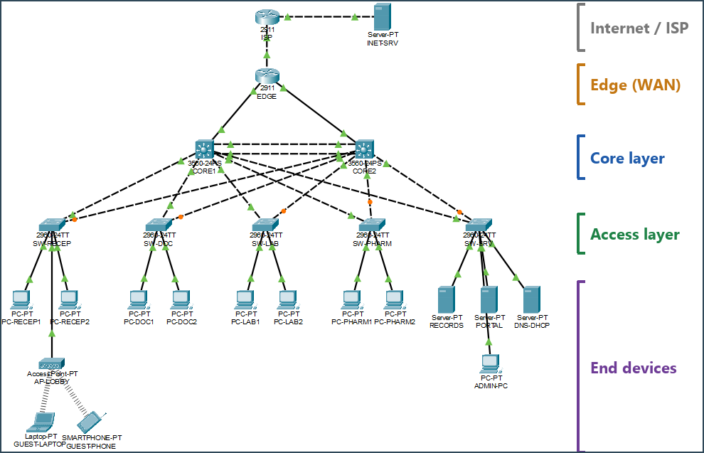

A mid-sized hospital has five departments (Reception, Doctors/OPD, Laboratory, Pharmacy, Server room) and a guest Wi-Fi lobby. A flat network fails it twice: anyone can reach patient records, and one switch or cable failure takes the whole hospital down. This project builds a network that:

- **separates** every department into its own VLAN with a VLSM addressing plan,
- **controls** which department can reach which server with ACLs,
- **survives** the loss of a core link or an entire core switch,
- **gives** staff and guests internet access, while guests never see hospital data,

and then **proves each of these with a test** (all 20 screenshots are below).

**Contents:** [Highlights](#highlights) · [Design](#design) · [Addressing](#addressing-plan) · [Access policy](#access-policy) · [Tests and screenshots](#tests-and-screenshots) · [Repository layout](#repository-layout) · [Running it](#running-it) · [Team](#team)

---

## Highlights

| | |
|---|---|
| **Core failover in ~2 s** | CORE1 powered off mid-ping: 198/200 replies, PCs unchanged (HSRP hello 1 s / hold 3 s) |
| **Link failure costs nothing** | One EtherChannel member shut during a ping: 60/60 replies |
| **Least-privilege access** | Per-department named ACLs on both cores, so the policy holds after failover |
| **Guests fully isolated** | Guest Wi-Fi gets DHCP, DNS and the internet, and nothing inside the hospital |
| **Hardened management** | SSH v2 only, only from the management VLAN, port security, unused ports shut in a black-hole VLAN |

## Design

Three layers, each with a clear job:

| Layer | Devices | What it does |
|---|---|---|
| **Internet** | ISP (2911), INET-SRV | Stands in for the provider and a public web server |
| **Edge** | EDGE (2911) | Default route to the ISP, PAT for the whole hospital, OSPF default origination |
| **Core** | CORE1, CORE2 (3560-24PS) | Inter-VLAN routing on SVIs, HSRP gateways, STP root, ACLs, OSPF area 0 |
| **Access** | SW-RECEP, SW-DOC, SW-LAB, SW-PHARM, SW-SRV (2960-24TT) | Department access ports, dual uplinks to both cores |
| **End devices** | 8 staff PCs, 3 servers, ADMIN-PC, lobby AP with guest laptop and phone | |

**Technologies:** VLANs and 802.1Q trunks · VLSM · LACP EtherChannel · Rapid-PVST · HSRP · SVI inter-VLAN routing · OSPF · static default route · PAT (NAT overload) · DHCP with relay · DNS · HTTP/HTTPS · FTP · named extended ACLs · port security · SSH v2

### Redundancy

- **Dual uplinks:** every access switch connects to both cores.
- **EtherChannel:** CORE1 and CORE2 are joined by Port-channel 1 (two links, LACP), carried as a trunk.
- **Rapid-PVST:** CORE1 is root primary and CORE2 root secondary for every VLAN, so the blocked uplink is always the one to CORE2.
- **HSRP:** every VLAN has a virtual gateway. CORE1 (priority 110) is Active and CORE2 (100) is Standby, with preempt and fast timers. The STP root and the HSRP Active router are the same switch, so traffic never takes a detour.

### Routing and services

- **OSPF area 0** on CORE1 (RID 1.1.1.1), CORE2 (2.2.2.2) and EDGE. SVIs are passive, so adjacencies form only on the two routed links to EDGE.
- **EDGE** has a static default route to the ISP and advertises it with `default-information originate`.
- **PAT** translates all of 172.16.10.0/23 to EDGE's public address 203.0.113.2.
- **DNS-DHCP** server holds five pools (one per user VLAN), reached via `ip helper-address` on both cores.
- **PORTAL** (staff website) and **RECORDS** (patient records over web and FTP) live in the Servers VLAN.

## Addressing plan

All internal addresses come from **172.16.10.0/23**, split with VLSM, largest subnet first. In every VLAN the first host is the HSRP virtual gateway, the second is CORE1 and the third is CORE2.

| VLAN | Name | Hosts | Subnet | Gateway (VIP) |
|---|---|---|---|---|
| 60 | Guest | 100 | 172.16.10.0/25 | 172.16.10.1 |
| 20 | Doctors | 50 | 172.16.10.128/26 | 172.16.10.129 |
| 10 | Reception | 25 | 172.16.10.192/27 | 172.16.10.193 |
| 30 | Lab | 25 | 172.16.10.224/27 | 172.16.10.225 |
| 99 | Management | 20 | 172.16.11.0/27 | 172.16.11.1 |
| 40 | Pharmacy | 12 | 172.16.11.32/27 | 172.16.11.33 |
| 50 | Servers | 10 | 172.16.11.64/28 | 172.16.11.65 |
| 999 | Blackhole | – | unused ports, shut down | – |
| – | CORE1 – EDGE | 2 | 172.16.11.80/30 | – |
| – | CORE2 – EDGE | 2 | 172.16.11.84/30 | – |
| – | EDGE – ISP | 2 | 203.0.113.0/30 (public) | – |

Servers: RECORDS 172.16.11.70, PORTAL 172.16.11.71, DNS-DHCP 172.16.11.72. Space left for growth: 172.16.11.88 – 172.16.11.255.

## Access policy

Named extended ACLs sit **inbound on the user SVIs of both cores**. Every user ACL also allows DHCP, DNS to 172.16.11.72 and ICMP echo-reply, then denies the rest of the hospital and permits the internet.

| From ↓ / To → | PORTAL web | RECORDS web | RECORDS FTP | Other departments | Management | Internet |
|---|:-:|:-:|:-:|:-:|:-:|:-:|
| **Doctors** | ✅ | ✅ | ✅ | ✅ | ❌ | ✅ |
| **Reception** | ✅ | ❌ | ❌ | ❌ | ❌ | ✅ |
| **Lab** | ✅ | ❌ | ✅ | ❌ | ❌ | ✅ |
| **Pharmacy** | ✅ | ✅ (http) | ❌ | ❌ | ❌ | ✅ |
| **Guest Wi-Fi** | ❌ | ❌ | ❌ | ❌ | ❌ | ✅ |

**Device hardening:** SSH v2 only on VTY lines, only from VLAN 99 (`access-class MGMT-SSH`), local user login, `enable secret`, `service password-encryption`. Access ports use port security (max 2, sticky, restrict). Every unused port is moved to VLAN 999 and shut down.

## Tests and screenshots

Every claim above was checked in Packet Tracer. Full-size originals are in [`screenshots/`](screenshots/).

### Switching

| VLANs on every switch | 802.1Q trunks |
|---|---|
| 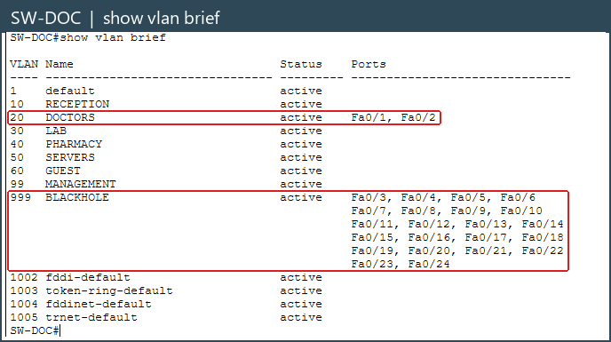 | 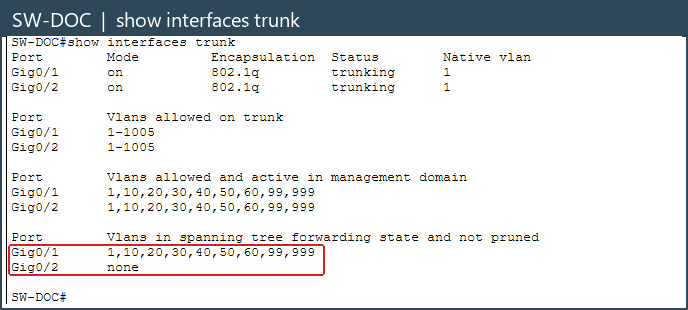 |
| **CORE1 is the STP root** | **Port-channel 1 bundled with LACP** |
| 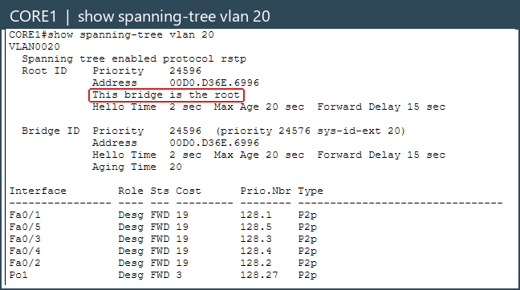 | 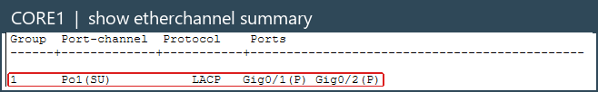 |

### Gateways, routing and services

| HSRP: CORE1 Active, CORE2 Standby for all 7 VLANs | OSPF neighbours and routes |
|---|---|
| 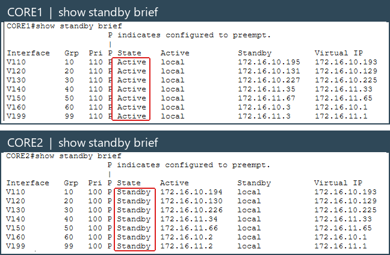 | 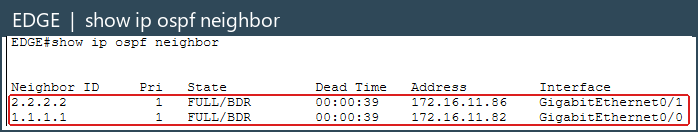 |
| **PC gets its address by DHCP** | **PAT on EDGE: 172.16.10.10 leaves as 203.0.113.2** |
| 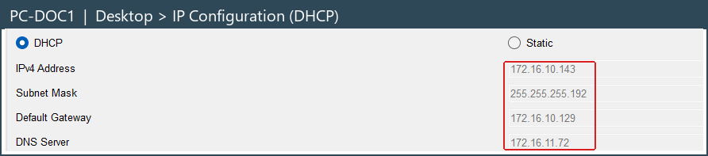 | 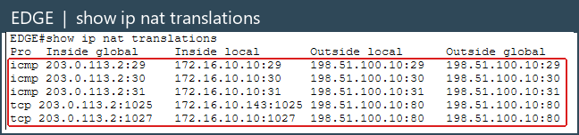 |

### Access policy

| ACL hit counters | Reception opens the staff PORTAL |
|---|---|
| 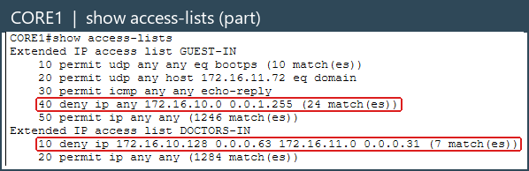 | 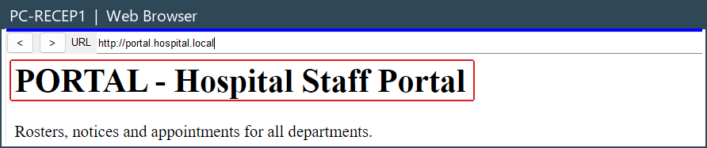 |
| **Reception blocked from RECORDS** | **Lab uploads results to RECORDS by FTP** |
|  | 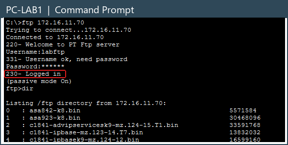 |
| **Guest blocked from hospital servers** | **Guest still reaches the internet** |
|  |  |

### Fault tolerance

| EtherChannel member shut: ping keeps replying | CORE1 powered off: about 2 s of loss |
|---|---|
| 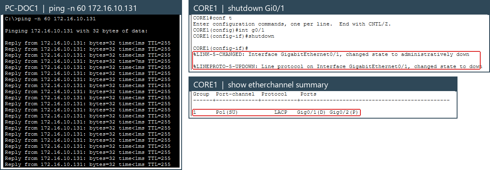 | 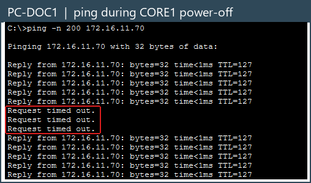 |
| **CORE2 takes over every gateway** | |
| 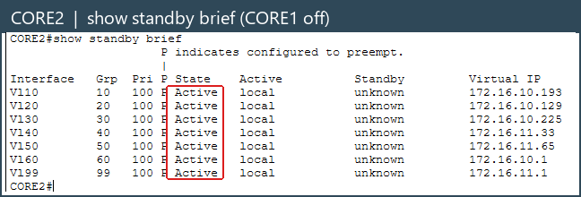 | |

### Management security

| SSH from ADMIN-PC (VLAN 99) works | SSH from any other VLAN is refused |
|---|---|
| 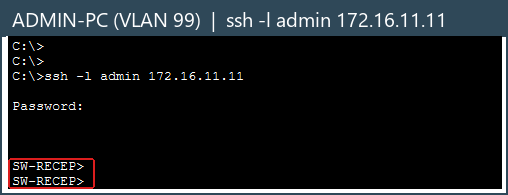 | 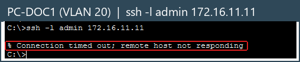 |

### Results summary

| # | Test | Result |
|---|---|---|
| 1 | VLANs present on all switches, trunks carry them | ✅ |
| 2 | CORE1 root bridge for every VLAN | ✅ |
| 3 | Po1 up with both members (LACP) | ✅ |
| 4 | HSRP Active/Standby split as designed | ✅ |
| 5 | OSPF adjacencies and default route learned | ✅ |
| 6 | DHCP leases in every user VLAN | ✅ |
| 7 | PAT for staff and guests | ✅ |
| 8 | Each department reaches exactly what the policy allows | ✅ |
| 9 | Guests isolated from the hospital, internet works | ✅ |
| 10 | One EtherChannel link lost: 60/60 replies | ✅ |
| 11 | CORE1 lost: 198/200 replies, CORE1 preempts back on return | ✅ |
| 12 | SSH only from the management VLAN | ✅ |

The full write-up, with design reasoning and every test, is in the **[project report (PDF)](report/Hospital_Network_Report.pdf)**.

## Repository layout

```
pkt/          Packet Tracer files, one per build stage
  hospital_v1_poc.pkt        proof of concept
  hospital_v2_vlans.pkt      VLANs and trunks
  hospital_v3_access.pkt     access layer
  hospital_v4_core.pkt       redundant core (EtherChannel, STP, HSRP)
  hospital_v5_routing.pkt    OSPF, default route, PAT
  hospital_v6_services.pkt   DHCP, DNS, web, FTP
  hospital_v7_secure.pkt     ACLs and hardening
  hospital_final.pkt         final, verified network
configs/      running config of every device (CORE1/2, EDGE, ISP, 5 access switches)
screenshots/  the 20 test screenshots, full size
report/       project report (docx + pdf) and the scripts that build it
  figures/        cropped screenshots used in the report and this README
  make_figures.py crops screenshots/ into figures/
  build_report.js builds the .docx
  to_pdf.ps1      exports the .docx to PDF with Microsoft Word
```

## Running it

**Open the network:** install [Cisco Packet Tracer](https://www.netacad.com/resources/lab-downloads) 9.0.1 or later and open `pkt/hospital_final.pkt`. Give it a minute after opening for STP, HSRP and OSPF to converge before you test. The earlier `pkt/` files show the network at each build stage.

**Rebuild the report** (optional):

```bash
cd report
npm install
node build_report.js
```

Then run `to_pdf.ps1` in PowerShell for the PDF (needs Microsoft Word). The published report lists team names only. To print registration numbers on the title page, add a `team.local.json` (git-ignored) mapping each name to its number.

> The device passwords in `configs/` are lab values for this simulation only.

## Team

- Anirudh A Menon
- Nagabhavit Pampati
- Chinmay Ghosh
- Adnan Ahmad Khan

Computer Networks (PE-7, Program Elective), Manipal Institute of Technology, Bengaluru, October 2026.
